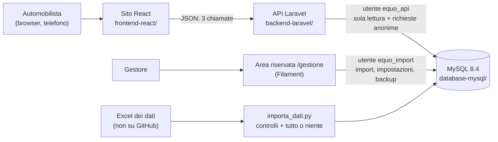

<p align="center">
  <picture>
    <source media="(prefers-color-scheme: dark)" srcset="docs/preparazione/05_Fase5-Asset/assets/logo-equo-dark.svg">
    
  </picture>
</p>

<h1 align="center">Is your mechanic's quote fair?</h1>

<p align="center">
  <strong>EQUO</strong> — web app mobile-first che dice in 60 secondi se il preventivo del meccanico è in linea con il mercato,<br>
  e spiega perché, voce per voce: ricambi, ricarico, manodopera, IVA.
</p>

<p align="center">
  
  
  
  
  
  
</p>

<p align="center">
  <a href="#in-breve">In breve</a> ·
  <a href="#il-problema">Problema</a> ·
  <a href="#lobiettivo">Obiettivo</a> ·
  <a href="#da-dove-sono-partito-la-v1">Da dove sono partito</a> ·
  <a href="#come-lho-implementato-la-v2">Come l'ho implementato</a> ·
  <a href="#come-si-calcola-la-stima">La stima</a> ·
  <a href="#il-problema-vero-i-dati">Il problema vero: i dati</a> ·
  <a href="#su-cosa-mi-concentro-adesso">Prossimi passi</a> ·
  <a href="#avvio-in-locale">Avvio</a>
</p>

---

## In breve

| | |
|---|---|
| **Cosa fa** | Scegli regione, auto, intervento, qualità dei ricambi, tipo di officina e importo del preventivo. EQUO calcola una stima equa, la confronta con il preventivo e dà un verdetto a semaforo con lo spaccato dei costi e un messaggio cordiale da mandare al meccanico. |
| **A che punto è** | Il **pilota funziona da capo a fondo** su 10 modelli (11 versioni), 10 interventi e 20 regioni: database, API, area riservata e sito sono completi, provati e protetti. **Non è ancora online.** |
| **Il limite** | Non è il software: sono **i dati**. Solo 2 prezzi dei ricambi su 73 sono verificati su più negozi; tariffe orarie e ricarichi sono ancora ipotesi dichiarate. La sezione [Il problema vero: i dati](#il-problema-vero-i-dati) lo spiega con i numeri. |
| **Il prossimo lavoro** | La ricerca dei dati: fonti ufficiali per i prezzi dei ricambi, ore di lavoro per motore, regole di confronto con i prezzi pubblicati online, e dopo il lancio i preventivi veri degli utenti. |

## Il problema

In Italia chi riceve un preventivo per l'auto non ha un riferimento oggettivo con cui confrontarlo. Le tariffe orarie della manodopera cambiano molto da regione a regione e tra concessionaria e officina indipendente; i prezzi dei ricambi sono opachi (originale, equivalente, economico) e il tempo di lavoro non viene quasi mai spiegato. Chiedere chiarimenti a voce mette a disagio. Il risultato è un'**asimmetria informativa**: chi paga non ha gli strumenti per capire se il prezzo è giusto.

## L'obiettivo

Dare all'automobilista un **verdetto spiegato**, non solo un numero:

- **stima equa scomponibile**: ricambi + ricarico dell'officina + manodopera (ore × tariffa oraria) + IVA, con una forbice "da… a…";
- **verdetto a semaforo**: equo (fino a +10%), sopra la media (fino a +25%), anomalo (oltre); e quando i dati non bastano, **"dati insufficienti"** invece di un verdetto inventato;
- **trasparenza sui dati**: per ogni ricambio si vede se il prezzo è verificato, indicativo o stimato, e da quando;
- **un messaggio cordiale** da copiare per riaprire il dialogo con l'officina, senza conflitto.

Tre principi fissi dalla prima versione: **zero registrazioni**, **nessun dato personale** (niente targa, PDF, GPS), **60 secondi**.

## Da dove sono partito: la V1

EQUO nasce nel corso **Boolean — VIBE CODING AI** con una pipeline di design AI-first in 9 fasi: scoping → MVP → paper prototype → wireframe → asset → design system → mockup e handoff → contesto per l'agente → build. Tutto il materiale è in [`docs/preparazione/`](docs/preparazione/00_LEGGIMI-PRIMA/README.md).

La **V1** (ottobre 2026) era un sito React con 7 schermate collegato a un webhook **n8n**: un nodo di codice con valori medi scritti a mano (20 regioni, 10 auto, 5 interventi), senza database.

<table>
  <tr>
    <td align="center"><br><sub><strong>Benvenuto</strong></sub></td>
    <td align="center"><br><sub><strong>Auto</strong></sub></td>
    <td align="center"><br><sub><strong>Prezzo</strong></sub></td>
    <td align="center"><br><sub><strong>Report</strong></sub></td>
  </tr>
</table>
<p align="center"><sub>Il design della V1 (dark UI, 360×800). Il sito attuale mantiene questa grafica e questa disposizione.</sub></p>

**Perché non bastava.** La V1 funzionava, ma i suoi numeri non si potevano verificare: medie fisse nel codice, nessuna fonte, nessuna data, nessuna distinzione tra motori, qualità dei ricambi o tipo di officina. Un verdetto su un preventivo reale ha bisogno di numeri che si possano ricontrollare. Da qui la **V2**: un pilota su 10 modelli in cui ogni prezzo ha una fonte, una data e un livello di affidabilità.

## Come l'ho implementato: la V2

### Metodo di lavoro

Tre fasi in ordine fisso, ognuna chiusa da un resoconto e da un'approvazione prima di passare alla successiva: **MySQL → Laravel → React**. Due regole valide per tutto il progetto:

- **ogni cambiamento ai dati o al metodo si applica solo se i numeri prima/dopo dimostrano che migliora**; altrimenti si torna indietro dal backup (è successo: un tentativo di mediare i prezzi di più siti dello stesso gruppo portava l'affidabilità da 72,6% a 72,5%, ed è stato annullato);
- **niente dati inventati**: dove manca un dato il sistema lo dice, e le ipotesi sono dichiarate come tali nel database.

### Architettura



### Fase 1 — Database (MySQL 8.4)

- **24 tabelle**: catalogo (marche, modelli, versioni, interventi, componenti, 73 codici ricambio), prezzi con **storico** (un prezzo non si sovrascrive mai, si chiude e se ne apre uno nuovo), 150 fonti con il loro livello di affidabilità, ore di lavoro, tariffe orarie per regione e tipo di officina, ricarichi, valori di mercato pubblicati, richieste anonime. Schema: [`database-mysql/SCHEMA.md`](database-mysql/SCHEMA.md).
- **Scala di affidabilità dei prezzi**: *rilevato* (2 o più negozi indipendenti), *indicativo* (1 negozio), *stimato* (mediana dei pezzi simili della stessa marca o della stessa categoria, con il metodo dichiarato).
- **4 procedure**: calcolo di stima e verdetto, controlli di copertura (cosa manca per ogni versione), taratura con i valori di mercato pubblicati.
- **Import da Excel** con controlli (fonti, date, IVA, scarto dei prezzi oltre il ±50% dalla mediana) e caricamento "tutto o niente"; backup e ripristino verificati con un inventario.

### Fase 2 — Backend (Laravel 13, PHP 8.5)

- **API per il sito**: 4 rotte (`/api/opzioni`, `/api/varianti`, `/api/verifica`, `/api/salute`), dati controllati campo per campo, errori in italiano, limiti di traffico (120 letture e 20 verifiche al minuto).
- **Calcolo della stima rifatto in PHP** con aritmetica decimale esatta: confrontato con la procedura MySQL su **14.202 casi, identico al centesimo**, verdetti compresi.
- **Sicurezza in 6 strati contro la manomissione dei dati**: nessuna rotta di modifica, controlli sui dati, modelli in sola lettura, **tre utenti MySQL separati** (l'API può solo leggere e aggiungere richieste anonime: MySQL rifiuta ogni modifica anche se il codice fosse compromesso), storico e vincoli, registro delle azioni non modificabile e backup.
- **Area riservata `/gestione`** (Filament): import dei dati in due passi (prova, poi conferma con backup automatico), impostazioni, accensione dei modelli e degli interventi, backup notturno, registro di accessi e azioni.
- **Controllo OWASP Top 10 (2025)**: 8 voci coperte, 2 parziali e dichiarate (verifica in due passaggi pronta ma spenta, avvisi automatici da fare). Nessuna password è mai finita su GitHub. **73 test automatici**, tutti verdi.

### Fase 3 — Sito (React 19, Vite, Tailwind)

La grafica della V1 è rimasta (colori, componenti, e la barra di avanzamento e la rotellina del design originale); sono cambiati i dati e sono state aggiunte solo le domande che il calcolo richiede:

Una domanda per schermata, con una barra di avanzamento: 1. regione → 2. auto (un elenco unico, una riga per versione) → 3. anno di immatricolazione (facoltativo, da un menù con i soli anni di produzione) → 4. intervento (pacchetti e pezzi singoli, o descritto a parole se manca) → 5. qualità dei ricambi → 6. tipo di officina → 7. importo → 8. IVA. Poi una rotellina di almeno 3 secondi e il report, con il prezzo calcolato in grande e subito sotto lo scarto in euro, in più o in meno.

Il report ha il semaforo, lo spaccato e il messaggio per il meccanico; il dettaglio (ricambi uno per uno, affidabilità, forbice, data dei prezzi) si apre con un pulsante. Gli interventi impossibili per una versione non compaiono (es. la frizione su una Yaris ibrida con cambio automatico).

## Come si calcola la stima

```
stima = ricambi + ricarico dell'officina sui ricambi + manodopera (ore × tariffa oraria) + IVA 22%
verdetto = (preventivo − stima) / stima   →   equo ≤ +10%  ·  sopra la media ≤ +25%  ·  anomalo oltre
```

Se manca anche un solo prezzo, o il tempo di lavoro, il verdetto è **"dati insufficienti"**: il sito mostra cosa manca e la stima parziale, senza semaforo. Un preventivo molto più basso della stima (oltre −25%) resta equo, con un avviso a controllare cosa comprende.

**Esempio reale** — Fiat Panda 1.2, tagliando completo, Lombardia, ricambi equivalenti, officina generica, preventivo 250 € IVA inclusa:

| Voce | Importo |
|---|---|
| Ricambi (candele, filtri olio/aria/abitacolo, olio) | 98,33 € |
| Ricarico dell'officina sui ricambi | 24,58 € |
| Manodopera: 1,41 ore × 54 €/ora | 76,14 € |
| IVA | 43,79 € |
| **Stima equa** (forbice 218,43 – 259,79 €) | **242,84 €** |
| Preventivo | 250,00 € → **+2,9% → Preventivo Equo** |

## Il problema vero: i dati

Il software fa quello che deve. **Il punto debole è la qualità dei numeri da cui parte.** Questa è la situazione misurata, senza abbellimenti.

### Quanto sono affidabili oggi

| Dato | Quantità | Da dove viene |
|---|---|---|
| Prezzi dei ricambi | 73 | **2 verificati** su 2 o più negozi, 13 indicativi (1 negozio), 35 stimati dalla mediana della stessa marca, 23 dalla mediana della categoria |
| Prezzi "solidi" (verificati, concordi entro il 25%, recenti) | **0** | anche i 2 verificati hanno negozi in disaccordo (es. filtro olio: 4,41 € contro 11,71 €) |
| Ore di lavoro | 104 | 62 da tempario, **42 ipotesi** |
| Tariffe orarie (20 regioni × 3 tipi di officina) | 60 | **tutte ipotesi**: le fonti pubblicate non sono concordi |
| Ricarichi sui ricambi | 6 | **ipotesi** |
| Affidabilità media dei ricambi | circa **70%** | obiettivo prima del lancio: 85% su tagliando e freni |

### Perché è difficile

1. **Un solo gruppo domina.** Tutti i 129 prezzi di riferimento vengono da siti dello stesso gruppo (Autodoc SE): quattro negozi che sembrano diversi sono in realtà un'unica fonte.
2. **I negozi non si lasciano leggere.** Un programma che si presenta con il proprio nome e rispetta le regole dei siti ha letto **0 prezzi su 13 pagine**: i negozi più grandi bloccano la lettura automatica già all'ingresso. Non aggiro i blocchi e non uso dati a pagamento.
3. **I costi per modello e motore quasi non esistono online.** Un censimento di 28 fonti sulle 109 combinazioni versione × intervento del pilota: 1 combinazione ha 3 o più fonti italiane, 4 ne hanno 2, 67 ne hanno 1 (quasi sempre un sito che a sua volta stima), 37 nessuna. E nessuna di queste fonti indica motore o generazione, quindi servono solo come controllo.
4. **Niente fatture reali**: la taratura si fa senza fatture, con i valori di mercato pubblicati.

**Un esempio concreto.** Per il tagliando della Panda in officina generica, le due forbici pubblicate (una rivista: 160–180 €; un sito che stima: 115–255 €) hanno una mediana di circa 177,50 €; la stima di EQUO è 242,84 €, circa il **37% sopra**. La tariffa oraria sembra in linea (54 €/ora contro una mediana pubblicata di 50 €/ora): lo scarto viene soprattutto da ricambi e ricarico. Con due sole fonti non basta per correggere, ma indica dove guardare.

## Su cosa mi concentro adesso

La fase successiva è l'**affinamento dei prezzi**. Il metodo: confrontare ogni nostro dato con tutte le fonti leggibili in modo lecito, calcolare la mediana, scartare i valori lontani oltre il 50%, ottenere una forbice di mercato e **correggere solo dove almeno 3 fonti indipendenti concordano**, e solo se i numeri prima/dopo migliorano.

| Priorità | Cosa | Perché |
|---|---|---|
| 1 | **Prezzi dei ricambi da canali ufficiali**: feed dei programmi di affiliazione (es. Awin) di più negozi e interfaccia per sviluppatori di eBay | è la parte più grande dello scarto, e l'unico modo lecito per avere più negozi indipendenti |
| 2 | **Ore di lavoro per motore** dai siti che le pubblicano (anche stranieri: le ore sono le stesse in ogni paese) | 42 ore su 104 sono ancora ipotesi |
| 3 | **Regole di confronto comuni**: stesso contenuto dell'intervento, stesso motore o generazione, IVA, data, un proprietario = una fonte | senza, si confrontano cose diverse |
| 4 | **Tariffe orarie e ricarichi** tarati sulle fonti pubblicate concordi | oggi sono ipotesi |
| 5 | **Dopo il lancio: i preventivi veri degli utenti**, già salvati in forma anonima | sono la fonte più forte; servono almeno 10 preventivi per combinazione |

**Prima di mettere il sito online** restano anche: riattivare la verifica in due passaggi dell'area riservata, configurazione di produzione con nuove credenziali, HTTPS, database non raggiungibile da internet, copia dei backup fuori dal server, avvisi automatici, e segnare i modelli pronti (il sito pubblico mostra solo quelli).

## Stack

| Livello | Tecnologia | Dettagli |
|---|---|---|
| **Sito** | React 19 · Vite 8 · Tailwind CSS 3.4 | mobile-first, una domanda per schermata (8 domande), componenti propri (Keypad, Semaforo, ListRow…) |
| **API e area riservata** | Laravel 13 · PHP 8.5 · Filament 5 | 4 rotte API, calcolo in aritmetica decimale (bcmath), sicurezza a strati |
| **Database** | MySQL 8.4 | 24 tabelle, 4 procedure, tre utenti con permessi separati |
| **Import** | Python 3 · openpyxl | dall'Excel dei dati, con controlli e caricamento "tutto o niente" |
| **Design** | pipeline AI-first (Stitch → Figma) | dark UI: Deep Night `#0B0F19` · Steel Blue `#1A365D` · Equo Mint `#38A169` |

## Struttura del repository

```
equo/
├── database-mysql/   # setup, schema storico, dati fissi, import, procedure, backup  → README e SCHEMA.md
├── backend-laravel/  # API per il sito, calcolo della stima, area riservata, test   → README
├── frontend-react/   # sito React (grafica della V1, dati dall'API)                 → README
└── docs/
    ├── preparazione/ # le 9 fasi della pipeline di design (V1)
    ├── architettura/ # diagramma del database (della fase 1)
    └── progetto/     # documenti di progetto del database
```

I dati raccolti (l'Excel con prezzi e fonti), i resoconti di lavoro e tutte le credenziali **non sono su GitHub**.

## Avvio in locale

Requisiti: MySQL 8.4 · PHP 8.2 o più recente (sviluppato con 8.5) con `bcmath` · Composer · Node.js 20+ · Python 3 con `openpyxl`.

L'installazione da zero **non è ancora un comando unico**: servono alcuni passi come amministratore di MySQL, perché il
database usa tre utenti con permessi separati. In sintesi, nell'ordine:

1. **database e utenti**: gli script in `database-mysql/setup/` creano il database e i tre utenti; le password si generano a caso e restano solo in file locali esclusi da git ([`database-mysql/README.md`](database-mysql/README.md));
2. **tabelle**: con le migration di Laravel (`php artisan migrate --database=schema`), poi i dati fissi e le procedure ([`backend-laravel/README.md`](backend-laravel/README.md));
3. **dati**: dall'Excel con `database-mysql/import/importa_dati.py` (l'Excel non è nel repository: senza, il sito si avvia ma non ci sono auto né prezzi da stimare);
4. **avvio**, una volta installato:
   ```bash
   cd backend-laravel && php artisan serve
   ```
   ```bash
   cd frontend-react && npm install && npm run dev
   ```
   Il sito si apre su http://localhost:5173 e usa l'API su http://localhost:8000. Il modello `backend-laravel/.env.example` ha le impostazioni di produzione: in locale vanno messi `APP_ENV=local` e `APP_DEBUG=true`.

## Documenti chiave

- [Database: installazione e tabelle](database-mysql/README.md) · [schema delle tabelle](database-mysql/SCHEMA.md) · [import](database-mysql/import/README.md) · [procedure](database-mysql/queries/README.md)
- [Backend: API, sicurezza, area riservata](backend-laravel/README.md)
- [Sito React](frontend-react/README.md)
- [PRD & Product Brief v3.0 (V1)](docs/preparazione/05_Fase5-Asset/output%20Stich/equo_prd_product_brief_v3.0.md) · [DESIGN.md](docs/preparazione/06_Fase6-Design-System-Layout/DESIGN.md) · [Handoff](docs/preparazione/07_Fase7-Mockup-Handoff/HANDOFF-PreventivoCheck.md)
- [Pipeline AI-first a 9 fasi](docs/preparazione/00_LEGGIMI-PRIMA/README.md) · [Indice](docs/preparazione/00_LEGGIMI-PRIMA/INDICE.md)

## Credits

Progetto nato nel corso **Boolean — VIBE CODING AI** (prodotto: **EQUO**, ex PreventivoCheck.web), sviluppato poi in tre fasi: database, backend e sito.
