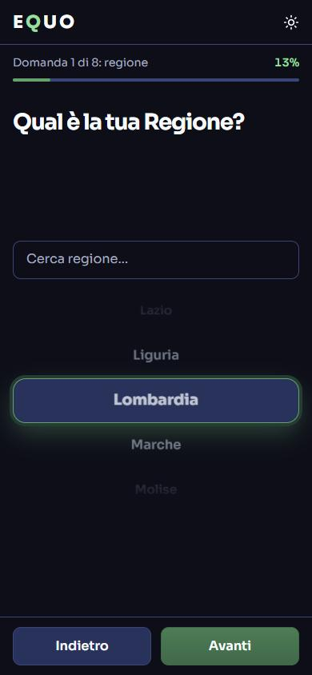
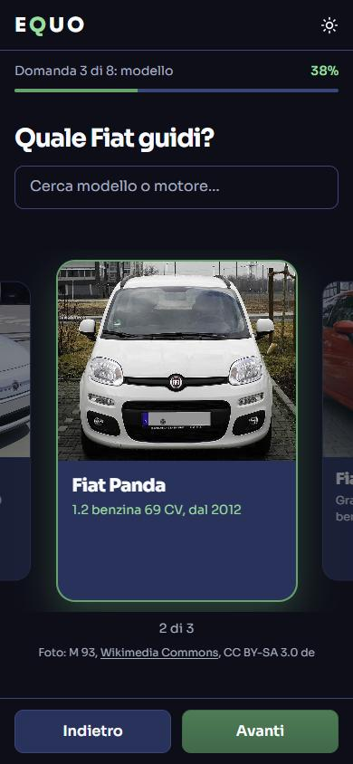
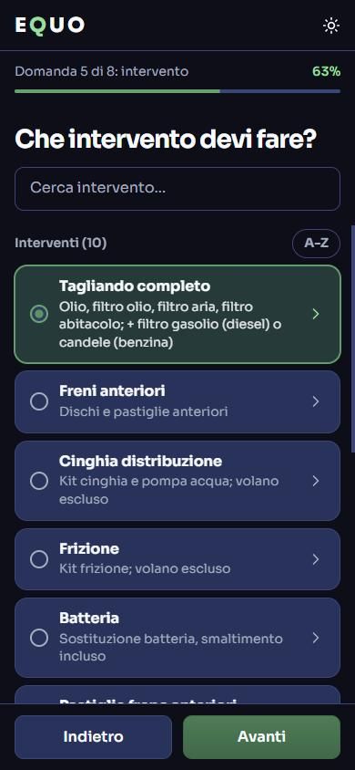
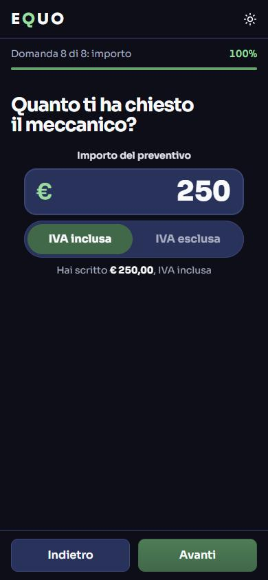
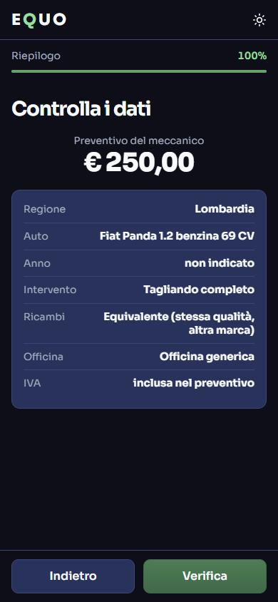
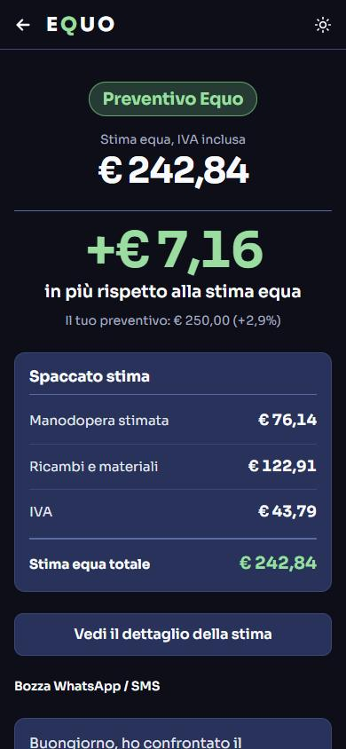
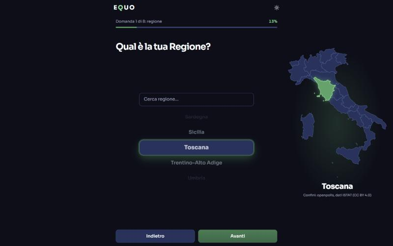
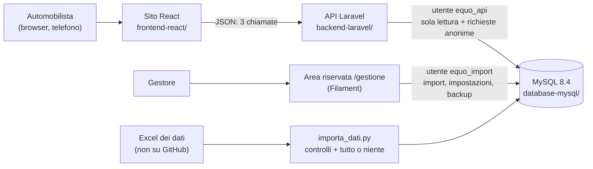

<p align="center">
  <picture>
    <source media="(prefers-color-scheme: dark)" srcset="docs/preparazione/05_Fase5-Asset/assets/logo-equo-dark.svg">
    
  </picture>
</p>

<h1 align="center">Is your mechanic's quote fair?</h1>

<p align="center">
  <strong>EQUO</strong> — web app mobile-first che dice in 60 secondi se il preventivo del meccanico è in linea con il mercato,<br>
  e spiega perché, voce per voce: ricambi, ricarico, manodopera, IVA.
</p>

<p align="center">
  
  
  
  
  
  
</p>

<p align="center">
  <a href="#in-breve">In breve</a> ·
  <a href="#il-sito-oggi">Il sito</a> ·
  <a href="#il-problema">Problema</a> ·
  <a href="#lobiettivo">Obiettivo</a> ·
  <a href="#da-dove-sono-partito-la-v1">Da dove sono partito</a> ·
  <a href="#come-lho-implementato-la-v2">Come l'ho implementato</a> ·
  <a href="#come-si-calcola-la-stima">La stima</a> ·
  <a href="#il-problema-vero-i-dati">Il problema vero: i dati</a> ·
  <a href="#su-cosa-mi-concentro-adesso">Prossimi passi</a> ·
  <a href="#avvio-in-locale">Avvio</a>
</p>

---

## In breve

| | |
|---|---|
| **Cosa fa** | Scegli regione, marca, modello, intervento, qualità dei ricambi, tipo di officina e importo del preventivo. EQUO calcola una stima equa, la confronta con il preventivo e dà un verdetto (equo, sopra la media, anomalo) con lo spaccato dei costi e un messaggio cordiale da mandare al meccanico. |
| **A che punto è** | Il **pilota funziona da capo a fondo** su 11 modelli (12 versioni), 10 interventi e 20 regioni: database, API, area riservata e sito sono completi, provati e protetti. **Non è ancora online.** |
| **Il limite** | Non è il software: sono **i dati**. Solo 2 prezzi dei ricambi su 81 sono verificati su più negozi; tariffe orarie e ricarichi sono ancora ipotesi dichiarate. La sezione [Il problema vero: i dati](#il-problema-vero-i-dati) lo spiega con i numeri. |
| **Il prossimo lavoro** | La ricerca dei dati: fonti ufficiali per i prezzi dei ricambi, ore di lavoro per motore, regole di confronto con i prezzi pubblicati online, e dopo il lancio i preventivi veri degli utenti. |

## Il sito oggi

Un percorso reale, con i dati del pilota: **Fiat Panda 1.2, tagliando completo, Lombardia, ricambi equivalenti, officina generica, preventivo 250 € IVA inclusa**. Le schermate sono quelle del telefono (390 px), in versione scura.

<table>
  <tr>
    <td align="center"><br><sub><strong>Home</strong><br>4 motivi da scorrere, un solo pulsante</sub></td>
    <td align="center"><br><sub><strong>Regione</strong><br>ruota di scelta con ricerca</sub></td>
    <td align="center"><br><sub><strong>Modello</strong><br>schede con la foto dell'auto</sub></td>
    <td align="center"><br><sub><strong>Intervento</strong><br>schede con descrizione e ordine A-Z</sub></td>
  </tr>
  <tr>
    <td align="center"><br><sub><strong>Importo</strong><br>tastiera numerica e IVA inclusa/esclusa</sub></td>
    <td align="center"><br><sub><strong>Riepilogo</strong><br>tutte le risposte prima di verificare</sub></td>
    <td align="center"><br><sub><strong>Risultato</strong><br>verdetto, scarto in euro e spaccato</sub></td>
    <td></td>
  </tr>
</table>

Su computer la home si apre su due colonne, con il pulsante grande in evidenza, e la scelta della regione mostra l'Italia sullo sfondo: la regione nella ruota si illumina sulla mappa, e un clic sulla mappa fa girare la ruota.

<table>
  <tr>
    <td align="center"><br><sub><strong>Home su computer</strong></sub></td>
    <td align="center"><br><sub><strong>Regione su computer, con la mappa</strong></sub></td>
  </tr>
</table>

## Il problema

In Italia chi riceve un preventivo per l'auto non ha un riferimento oggettivo con cui confrontarlo. Le tariffe orarie della manodopera cambiano molto da regione a regione e tra concessionaria e officina indipendente; i prezzi dei ricambi sono opachi (originale, equivalente, economico) e il tempo di lavoro non viene quasi mai spiegato. Chiedere chiarimenti a voce mette a disagio. Il risultato è un'**asimmetria informativa**: chi paga non ha gli strumenti per capire se il prezzo è giusto.

## L'obiettivo

Dare all'automobilista un **verdetto spiegato**, non solo un numero:

- **stima equa scomponibile**: ricambi + ricarico dell'officina + manodopera (ore × tariffa oraria) + IVA, con una forbice "da… a…";
- **verdetto a tre livelli**: equo (fino a +10%), sopra la media (fino a +25%), anomalo (oltre); e quando i dati non bastano, **"dati insufficienti"** invece di un verdetto inventato;
- **trasparenza sui dati**: per ogni ricambio si vede se il prezzo è verificato, indicativo o stimato;
- **un messaggio cordiale** da copiare per riaprire il dialogo con l'officina, senza conflitto.

Tre principi fissi dalla prima versione: **zero registrazioni**, **nessun dato personale** (niente targa, PDF, GPS), **60 secondi**.

## Da dove sono partito: la V1

EQUO nasce nel corso **Boolean — VIBE CODING AI** con una pipeline di design AI-first in 9 fasi: scoping → MVP → paper prototype → wireframe → asset → design system → mockup e handoff → contesto per l'agente → build. Tutto il materiale è in [`docs/preparazione/`](docs/preparazione/00_LEGGIMI-PRIMA/README.md).

La **V1** (ottobre 2026) era un sito React con 7 schermate collegato a un webhook **n8n**: un nodo di codice con valori medi scritti a mano (20 regioni, 10 auto, 5 interventi), senza database.

<table>
  <tr>
    <td align="center"><br><sub><strong>Benvenuto</strong></sub></td>
    <td align="center"><br><sub><strong>Auto</strong></sub></td>
    <td align="center"><br><sub><strong>Prezzo</strong></sub></td>
    <td align="center"><br><sub><strong>Report</strong></sub></td>
  </tr>
</table>
<p align="center"><sub>Il design della V1 (dark UI, 360×800). Il sito attuale ne conserva i colori (notte, blu acciaio, verde menta) con una grafica nuova: vedi <a href="#il-sito-oggi">Il sito oggi</a>.</sub></p>

**Perché non bastava.** La V1 funzionava, ma i suoi numeri non si potevano verificare: medie fisse nel codice, nessuna fonte, nessuna data, nessuna distinzione tra motori, qualità dei ricambi o tipo di officina. Un verdetto su un preventivo reale ha bisogno di numeri che si possano ricontrollare. Da qui la **V2**: un pilota su pochi modelli in cui ogni prezzo ha una fonte, una data e un livello di affidabilità.

## Come l'ho implementato: la V2

### Metodo di lavoro

Tre fasi in ordine fisso, ognuna chiusa da un resoconto e da un'approvazione prima di passare alla successiva: **MySQL → Laravel → React**. Due regole valide per tutto il progetto:

- **ogni cambiamento ai dati o al metodo si applica solo se i numeri prima/dopo dimostrano che migliora**; altrimenti si torna indietro dal backup (è successo: un tentativo di mediare i prezzi di più siti dello stesso gruppo portava l'affidabilità da 72,6% a 72,5%, ed è stato annullato);
- **niente dati inventati**: dove manca un dato il sistema lo dice, e le ipotesi sono dichiarate come tali nel database.

### Architettura



### Fase 1 — Database (MySQL 8.4)

- **24 tabelle**: catalogo (marche, modelli, versioni, interventi, componenti, 81 codici ricambio), prezzi con **storico** (un prezzo non si sovrascrive mai, si chiude e se ne apre uno nuovo), oltre 150 fonti con il loro livello di affidabilità, ore di lavoro, tariffe orarie per regione e tipo di officina, ricarichi, valori di mercato pubblicati, richieste anonime. Schema: [`database-mysql/SCHEMA.md`](database-mysql/SCHEMA.md).
- **Scala di affidabilità dei prezzi**: *rilevato* (2 o più negozi indipendenti), *indicativo* (1 negozio), *stimato* (mediana dei pezzi simili della stessa marca o della stessa categoria, con il metodo dichiarato).
- **4 procedure**: calcolo di stima e verdetto, controlli di copertura (cosa manca per ogni versione), taratura con i valori di mercato pubblicati.
- **Import da Excel** con controlli (fonti, date, IVA, scarto dei prezzi oltre il ±50% dalla mediana) e caricamento "tutto o niente"; backup e ripristino verificati con un inventario.

### Fase 2 — Backend (Laravel 13, PHP 8.5)

- **API per il sito**: 4 rotte (`/api/opzioni`, `/api/varianti`, `/api/verifica`, `/api/salute`), dati controllati campo per campo, errori in italiano, limiti di traffico (120 letture e 20 verifiche al minuto).
- **Calcolo della stima rifatto in PHP** con aritmetica decimale esatta: confrontato con la procedura MySQL su **14.202 casi, identico al centesimo**, verdetti compresi.
- **Sicurezza in 6 strati contro la manomissione dei dati**: nessuna rotta di modifica, controlli sui dati, modelli in sola lettura, **tre utenti MySQL separati** (l'API può solo leggere e aggiungere richieste anonime: MySQL rifiuta ogni modifica anche se il codice fosse compromesso), storico e vincoli, registro delle azioni non modificabile e backup.
- **Area riservata `/gestione`** (Filament): import dei dati in due passi (prova, poi conferma con backup automatico), impostazioni, accensione dei modelli e degli interventi, backup notturno, registro di accessi e azioni.
- **Controllo OWASP Top 10 (2025)**: 8 voci coperte, 2 parziali e dichiarate (verifica in due passaggi pronta ma spenta, avvisi automatici da fare). Nessuna password è mai finita su GitHub.
- **73 test automatici**, tutti verdi, provati anche su un'installazione da zero.

### Fase 3 — Sito (React 19, Vite)

Il sito è stato ridisegnato tenendo i colori della V1 e cambiando tutto il resto: tipografia (Sora), componenti e disposizione delle schermate. Le scelte principali, prese provando le schermate su un iPhone vero:

- **8 domande, una per schermata**, con la barra di avanzamento in alto e **"Indietro"/"Avanti" sempre visibili in fondo**: la pagina non scorre mai, scorre solo il contenuto (elenco, ruota, schede). Il gesto "indietro" del telefono torna alla domanda precedente senza uscire dal sito.
- **Regione e marca con una ruota di scelta** (come quelle del telefono) più la ricerca; su computer la regione si illumina su una **mappa dell'Italia** con i confini ufficiali ISTAT.
- **Modello a schede con la foto** dell'auto, perché molti riconoscono la propria auto a vista ma non ne sanno il nome; le sigle di progetto ("Panda (319)") restano solo nel messaggio per il meccanico.
- **Versioni che cambiano solo per il periodo** (per esempio la Fiat 500 prima e dopo il restyling del 2015) sono una sola scheda: la versione giusta la sceglie l'anno di immatricolazione, e solo se l'anno non basta compare una domanda con la foto del dettaglio che le distingue (i fanali posteriori).
- **Intervento, ricambi e officina a schede** con il pallino di selezione; **importo** in un campo con la tastiera numerica del telefono e il selettore **IVA inclusa / esclusa** subito sotto.
- **Riepilogo** prima della verifica, poi una rotellina di almeno 3 secondi e il **risultato**: verdetto, stima equa e scarto in euro in grande, spaccato dei costi, dettaglio voce per voce e messaggio da copiare.
- **Versione chiara e scura** (segue il telefono, con un interruttore), **responsive** su telefono, tablet e computer (home a tutto schermo con footer), e un controllo automatico di qualità grafica e accessibilità ([Hallmark](https://github.com/nutlope/hallmark)) a ogni modifica: colori da un'unica tavolozza, contrasti, bordo visibile per chi usa la tastiera, rispetto di chi preferisce meno animazioni.

Gli interventi impossibili per una versione non compaiono (es. la frizione su una Yaris ibrida con cambio automatico).

## Come si calcola la stima

```
stima = ricambi + ricarico dell'officina sui ricambi + manodopera (ore × tariffa oraria) + IVA 22%
verdetto = (preventivo − stima) / stima   →   equo ≤ +10%  ·  sopra la media ≤ +25%  ·  anomalo oltre
```

Se manca anche un solo prezzo, o il tempo di lavoro, il verdetto è **"dati insufficienti"**: il sito mostra cosa manca e la stima parziale, senza verdetto. Un preventivo molto più basso della stima (oltre −25%) resta equo, con un avviso a controllare cosa comprende.

**Esempio reale** — è il percorso delle schermate qui sopra: Fiat Panda 1.2, tagliando completo, Lombardia, ricambi equivalenti, officina generica, preventivo 250 € IVA inclusa:

| Voce | Importo |
|---|---|
| Ricambi (candele, filtri olio/aria/abitacolo, olio) | 98,33 € |
| Ricarico dell'officina sui ricambi | 24,58 € |
| Manodopera: 1,41 ore × 54 €/ora | 76,14 € |
| IVA | 43,79 € |
| **Stima equa** (forbice 218,43 – 259,79 €) | **242,84 €** |
| Preventivo | 250,00 € → **+7,16 € (+2,9%) → Preventivo Equo** |

## Il problema vero: i dati

Il software fa quello che deve. **Il punto debole è la qualità dei numeri da cui parte.** Questa è la situazione misurata, senza abbellimenti.

### Quanto sono affidabili oggi

| Dato | Quantità | Da dove viene |
|---|---|---|
| Prezzi dei ricambi | 81 | **2 verificati** su 2 o più negozi, 13 indicativi (1 negozio), 66 stimati dalla mediana della stessa marca o della categoria |
| Prezzi "solidi" (verificati, concordi entro il 25%, recenti) | **0** | anche i 2 verificati hanno negozi in disaccordo (es. filtro olio: 4,41 € contro 11,71 €) |
| Ore di lavoro | 114 | 70 da tempario, **44 ipotesi** |
| Tariffe orarie (20 regioni × 3 tipi di officina) | 60 | **tutte ipotesi**: le fonti pubblicate non sono concordi |
| Ricarichi sui ricambi | 6 | **ipotesi** |
| Affidabilità media dei ricambi | circa **70%** | obiettivo prima del lancio: 85% su tagliando e freni |

### Perché è difficile

1. **Un solo gruppo domina.** Tutti i 129 prezzi di riferimento vengono da siti dello stesso gruppo (Autodoc SE): quattro negozi che sembrano diversi sono in realtà un'unica fonte.
2. **I negozi non si lasciano leggere.** Un programma che si presenta con il proprio nome e rispetta le regole dei siti ha letto **0 prezzi su 13 pagine**: i negozi più grandi bloccano la lettura automatica già all'ingresso. Non aggiro i blocchi e non uso dati a pagamento.
3. **I costi per modello e motore quasi non esistono online.** Un censimento di 28 fonti sulle 109 combinazioni versione × intervento del pilota: 1 combinazione ha 3 o più fonti italiane, 4 ne hanno 2, 67 ne hanno 1 (quasi sempre un sito che a sua volta stima), 37 nessuna. E nessuna di queste fonti indica motore o generazione, quindi servono solo come controllo.
4. **Niente fatture reali**: la taratura si fa senza fatture, con i valori di mercato pubblicati.

**Un esempio concreto.** Per il tagliando della Panda in officina generica, le due forbici pubblicate (una rivista: 160–180 €; un sito che stima: 115–255 €) hanno una mediana di circa 177,50 €; la stima di EQUO è 242,84 €, circa il **37% sopra**. La tariffa oraria sembra in linea (54 €/ora contro una mediana pubblicata di 50 €/ora): lo scarto viene soprattutto da ricambi e ricarico. Con due sole fonti non basta per correggere, ma indica dove guardare.

## Su cosa mi concentro adesso

La fase successiva è l'**affinamento dei prezzi**. Il metodo: confrontare ogni nostro dato con tutte le fonti leggibili in modo lecito, calcolare la mediana, scartare i valori lontani oltre il 50%, ottenere una forbice di mercato e **correggere solo dove almeno 3 fonti indipendenti concordano**, e solo se i numeri prima/dopo migliorano.

| Priorità | Cosa | Perché |
|---|---|---|
| 1 | **Prezzi dei ricambi da canali ufficiali**: feed dei programmi di affiliazione (es. Awin) di più negozi e interfaccia per sviluppatori di eBay | è la parte più grande dello scarto, e l'unico modo lecito per avere più negozi indipendenti |
| 2 | **Ore di lavoro per motore** dai siti che le pubblicano (anche stranieri: le ore sono le stesse in ogni paese) | 44 ore su 114 sono ancora ipotesi |
| 3 | **Regole di confronto comuni**: stesso contenuto dell'intervento, stesso motore o generazione, IVA, data, un proprietario = una fonte | senza, si confrontano cose diverse |
| 4 | **Tariffe orarie e ricarichi** tarati sulle fonti pubblicate concordi | oggi sono ipotesi |
| 5 | **Dopo il lancio: i preventivi veri degli utenti**, già salvati in forma anonima | sono la fonte più forte; servono almeno 10 preventivi per combinazione |

**Prima di mettere il sito online** restano anche: riattivare la verifica in due passaggi dell'area riservata, configurazione di produzione con nuove credenziali, HTTPS, database non raggiungibile da internet, copia dei backup fuori dal server, avvisi automatici, e segnare i modelli pronti (il sito pubblico mostra solo quelli).

## Stack

| Livello | Tecnologia | Dettagli |
|---|---|---|
| **Sito** | React 19 · Vite 8 · CSS con variabili | mobile-first e responsive, 8 domande, versione chiara e scura, componenti propri (ruota di scelta, schede con foto, mappa delle regioni, riepilogo…) |
| **API e area riservata** | Laravel 13 · PHP 8.5 · Filament 5 | 4 rotte API, calcolo in aritmetica decimale (bcmath), sicurezza a strati |
| **Database** | MySQL 8.4 | 24 tabelle, 4 procedure, tre utenti con permessi separati |
| **Import** | Python 3 · openpyxl | dall'Excel dei dati, con controlli e caricamento "tutto o niente" |
| **Design** | V1: pipeline AI-first (Stitch → Figma) · V2: ridisegno con Hallmark | colori della V1: Deep Night `#0B0F19` · Steel Blue `#1A365D` · Equo Mint `#38A169`; carattere Sora |

## Struttura del repository

```
equo/
├── database-mysql/   # setup, dati del catalogo, import, procedure, backup  → README e SCHEMA.md
├── backend-laravel/  # API per il sito, calcolo della stima, area riservata, test   → README
├── frontend-react/   # sito React (8 domande, foto dei modelli, mappa, tema chiaro e scuro) → README
└── docs/
    ├── screenshots/  # le schermate di questo README
    ├── preparazione/ # le 9 fasi della pipeline di design (V1)
    ├── architettura/ # diagramma del database (della fase 1)
    └── progetto/     # documenti di progetto del database
```

I dati del catalogo sono su GitHub (`database-mysql/seed/03_catalogo.sql`, senza dati personali); l'Excel di lavoro da cui vengono, i resoconti di lavoro e tutte le credenziali **no**.

## Avvio in locale

Requisiti: Windows · MySQL 8.4 · PHP 8.4 o più recente (sviluppato con 8.5) con `bcmath`, `intl`, `pdo_mysql` · Composer · Node.js 20+ · Python 3.

Il database usa tre utenti con permessi separati, quindi due passi si fanno come amministratore di MySQL. Le password si generano a caso e restano solo in file locali esclusi da git. I **dati del catalogo** (auto, ricambi, prezzi con le loro fonti, ore, tariffe) sono nel repository, in `database-mysql/seed/03_catalogo.sql`: dopo l'installazione il sito funziona subito con i 10 modelli del pilota.

La guida completa, passo per passo, è in [`database-mysql/README.md` → Installazione da zero](database-mysql/README.md#installazione-da-zero): provata da zero su un MySQL vuoto, finisce con i 73 test verdi. In sintesi:

1. genera password e configurazione (`database-mysql/setup/genera_utenti.py`);
2. crea i database e l'utente della struttura, come root;
3. crea le tabelle con le migration di Laravel;
4. crea gli altri due utenti, come root;
5. carica i dati del catalogo e le procedure;
6. prova con `php artisan test` e avvia:
   ```bash
   cd backend-laravel && php artisan serve
   ```
   ```bash
   cd frontend-react && npm install && npm run dev
   ```
   Il sito si apre su http://localhost:5173 e usa l'API su http://localhost:8000.

## Documenti chiave

- [Database: installazione e tabelle](database-mysql/README.md) · [schema delle tabelle](database-mysql/SCHEMA.md) · [import](database-mysql/import/README.md) · [procedure](database-mysql/queries/README.md)
- [Backend: API, sicurezza, area riservata](backend-laravel/README.md)
- [Sito React](frontend-react/README.md)
- [PRD & Product Brief v3.0 (V1)](docs/preparazione/05_Fase5-Asset/output%20Stich/equo_prd_product_brief_v3.0.md) · [DESIGN.md](docs/preparazione/06_Fase6-Design-System-Layout/DESIGN.md) · [Handoff](docs/preparazione/07_Fase7-Mockup-Handoff/HANDOFF-PreventivoCheck.md)
- [Pipeline AI-first a 9 fasi](docs/preparazione/00_LEGGIMI-PRIMA/README.md) · [Indice](docs/preparazione/00_LEGGIMI-PRIMA/INDICE.md)

## Credits

Progetto nato nel corso **Boolean — VIBE CODING AI** (prodotto: **EQUO**, ex PreventivoCheck.web), sviluppato poi in tre fasi: database, backend e sito.

- **Foto dei modelli**: Wikimedia Commons, con licenze libere; autore e licenza di ogni foto sono indicati nel sito sotto la foto e in [`frontend-react/src/data/fotoModelli.js`](frontend-react/src/data/fotoModelli.js) (autori: M 93, Rudolf Stricker, Vauxford, Lothar Spurzem, Antoineets).
- **Confini delle regioni**: [openpolis/geojson-italy](https://github.com/openpolis/geojson-italy), dati ISTAT, licenza CC BY 4.0.
- **Controllo grafico del sito**: [Hallmark](https://github.com/nutlope/hallmark).
