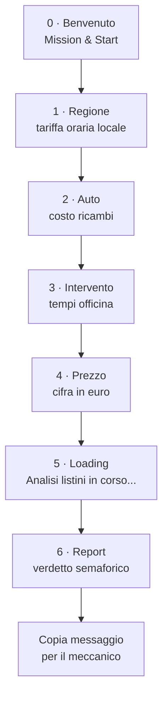

<p align="center">
  <picture>
    <source media="(prefers-color-scheme: dark)" srcset="05_Fase5-Asset/assets/logo-equo-dark.svg">
    
  </picture>
</p>

<h1 align="center">Is your mechanic's quote fair?</h1>

<p align="center">
  <strong>EQUO</strong> — web app mobile-first che verifica in 60 secondi la congruità di un preventivo auto,<br>
  confrontandolo con le tariffe orarie regionali e i prezzi medi dei ricambi.
</p>

<p align="center">
  
  
  
  
  
</p>

<p align="center">
  <a href="#il-problema">Problema</a> ·
  <a href="#la-soluzione">Soluzione</a> ·
  <a href="#come-funziona">Come funziona</a> ·
  <a href="#le-schermate">Schermate</a> ·
  <a href="#stack-e-architettura">Stack</a> ·
  <a href="#struttura-del-repo">Struttura</a> ·
  <a href="#stato-e-roadmap">Stato</a> ·
  <a href="#getting-started">Getting started</a> ·
  <a href="#documenti-chiave">Docs</a>
</p>

---

## Il problema

_The problem_

In Italia l'automobilista riceve un preventivo senza alcun riferimento oggettivo con cui confrontarlo: le tariffe orarie della manodopera variano forte da regione a regione, i prezzi dei ricambi sono opachi (originali OEM vs compatibili) e chiedere chiarimenti a voce con il meccanico mette a disagio. Ne risulta un'**asimmetria informativa** strutturale — chi paga non ha gli strumenti per capire se il prezzo è equo.

## La soluzione

_The solution_

**EQUO** è una web app a bassissimo attrito: **zero registrazioni**, nessun PDF da caricare, nessuna targa, nessun GPS. Quattro passaggi — regione, auto, tipo di intervento, importo preventivato — e in meno di 60 secondi si ottiene un report con:

- **verdetto semaforico** (entro la media / sopra la media +10–25% / molto sopra la media +25%);
- **scostamento in euro** rispetto ai benchmark regionali;
- **bozza di messaggio WhatsApp** cordiale e non conflittuale, pronta da copiare con un tocco per riaprire il dialogo con l'officina.

| Tempo | Copertura | Costo | Privacy |
|---|---|---|---|
| **< 60 sec** | **20 regioni** italiane | **100% gratuito** | **Zero dati** — no account, no PDF, no GPS, no targa |

## Come funziona

_How it works_



Il frontend invia solo quattro nomi + importo (`POST` JSON). A calcolare è il **backend n8n**: un nodo Code con benchmark regionali in-memory (20 regioni, 10 auto, 5 interventi) restituisce verdetto e spaccato dei costi. Nessun database, nessuna persistenza: il report si copia e si chiude.

## Le schermate

_The screens_ — dark UI, viewport target 360×800

<table>
  <tr>
    <td align="center">
      <br>
      <sub><strong>0 · Benvenuto</strong></sub>
    </td>
    <td align="center">
      <br>
      <sub><strong>1 · Regione</strong></sub>
    </td>
    <td align="center">
      <br>
      <sub><strong>2 · Auto</strong></sub>
    </td>
    <td align="center">
      <br>
      <sub><strong>3 · Intervento</strong></sub>
    </td>
  </tr>
  <tr>
    <td align="center">
      <br>
      <sub><strong>4 · Prezzo</strong></sub>
    </td>
    <td align="center">
      <br>
      <sub><strong>5 · Loading</strong></sub>
    </td>
    <td align="center">
      <br>
      <sub><strong>6 · Report</strong></sub>
    </td>
    <td></td>
  </tr>
</table>

## Stack e architettura

_Tech stack_

| Livello | Tecnologia | Dettagli |
|---|---|---|
| **Frontend** | React 19 · Vite 8 · Tailwind CSS 3.4 | Mobile-first, 7 schermate, componenti custom (`Keypad`, `Semaforo`, `StickyFooter`, `SearchBar`, `ListRow`, `ProgressBar`) |
| **Backend** | n8n webhook | Nodo Code con benchmark in-memory: 20 regioni, 10 auto, 5 interventi — **zero database** |
| **Protocollo** | REST / JSON | `POST { regione, auto, intervento, prezzo }` → verdetto + spaccato costi; mock locale se l'env è vuoto |
| **Design** | Pipeline AI-first (Stitch → Figma) | Dark UI: Deep Night `#0B0F19` · Steel Blue `#1A365D` · Equo Mint `#38A169` |

## Struttura del repo

_Repository structure_

```
equo/
├── 00_LEGGIMI-PRIMA/               # Indice, gate di fase, leggimi
├── 01_Fase1-Scoping/               # Problema, target, valore
├── 02_Fase2-MVP0-PreventivoCheck/  # Scope MVP congelato (chiusa 2026-09-10)
├── 03_Fase3-Paper-Prototype/       # Flusso schermate, schede
├── 04_Fase4-Wireframe/             # Wireframe low-fi + export Stitch
├── 05_Fase5-Asset/                 # Logo, palette, schermate dark, PRD v3.0
├── 06_Fase6-Design-System-Layout/  # DESIGN.md (colori, tipografia, componenti)
├── 07_Fase7-Mockup-Handoff/        # Mockup hi-fi + handoff per il build
├── 08_Fase8-Agent-Workspace/       # Agent.md + workspace.md (contesto AI vivo)
├── 09_Fase9-App-Frontend/          # App React + workflow n8n
│   ├── equo-frontend-v1/           # sorgenti React/Vite/Tailwind
│   └── equo-n8n-backend-v1.json    # workflow n8n importabile
└── _Archivio-Template-Originali/   # Template originali (non modificare)
```

Ogni cartella `0X_` è una fase della pipeline AI-first: un artefatto prepara il passo successivo, e i gate di fase ne certificano la chiusura.

## Stato e roadmap

_Status & roadmap_

| Fase | Output | Stato |
|---|---|---|
| 01 Scoping | scheda scoping | Da recuperare (la Fase 2 è stata chiusa senza scoping formale) |
| 02 MVP0 | scheda-mvp, Agent, workspace | **Chiusa — 2026-09-10** |
| 03 Paper Prototype | flusso schermate | Completa |
| 04 Wireframe | wireframe + export | Completa |
| 05 Asset | logo, palette, schermate | Completa |
| 06 Design System + Layout | DESIGN.md + layout | Completa |
| 07 Mockup + Handoff | mockup hi-fi + handoff | Completa |
| 08 Agent + Workspace | Agent.md, workspace.md | Completa |
| 09 App Frontend | React + n8n | **In corso** — v1 con 7 schermate |

**Non-goal (mai):** export PDF del report · geolocalizzazione GPS · login/account e database.

**Post-MVP:** ricerca auto via targa (API esterna) · distinzione pezzi OEM vs aftermarket · storico verifiche.

## Getting started

_Run it locally_

**Prerequisiti:** Node.js 20+ · n8n (opzionale, per il backend reale)

```bash
git clone https://github.com/lucariggi92/equo.git
cd equo/09_Fase9-App-Frontend/equo-frontend-v1
npm install
npm run dev
```

**Backend n8n** (opzionale — senza env il frontend usa un mock locale):

1. Importa `09_Fase9-App-Frontend/equo-n8n-backend-v1.json` in n8n;
2. attiva il webhook `equo-verifica`;
3. copia `.env.example` in `.env` e imposta `VITE_N8N_VERIFICA_URL`.

Comandi utili: `npm run dev` · `npm run build` · `npm run lint`.

## Documenti chiave

_Key documents_

- [PRD & Product Brief v3.0](05_Fase5-Asset/output%20Stich/equo_prd_product_brief_v3.0.md)
- [Agent.md — istruzioni vive del progetto](08_Fase8-Agent-Workspace/Agent.md)
- [workspace.md — log append-only delle decisioni](08_Fase8-Agent-Workspace/workspace.md)
- [DESIGN.md — design system](06_Fase6-Design-System-Layout/DESIGN.md)
- [Handoff per il build](07_Fase7-Mockup-Handoff/HANDOFF-PreventivoCheck.md)
- [Indice del progetto](00_LEGGIMI-PRIMA/INDICE.md)
- [Pipeline AI-first a 9 fasi](00_LEGGIMI-PRIMA/README.md)

## Credits

Progetto realizzato nel corso **Boolean — VIBE CODING AI** con una pipeline di design AI-first a 9 fasi: scoping → MVP → paper prototype → wireframe → asset → design system → handoff → contesto agent → build. Prodotto: **EQUO** (ex PreventivoCheck.web).
