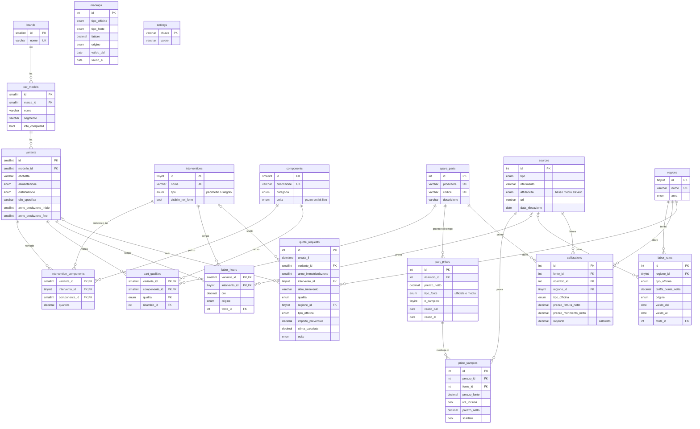

# Schema del database `equo`

Le 18 tabelle create da `schema/01_schema.sql` e i loro collegamenti. GitHub disegna il diagramma da solo; la versione in immagine è in [`../docs/architettura/schema-database-equo.png`](../docs/architettura/schema-database-equo.png).
Nomi delle tabelle in inglese, nomi delle colonne in italiano (revisione PM del 2026-11-12).

## Corrispondenza con i nomi vecchi

| Prima | Ora | | Prima | Ora |
|---|---|---|---|---|
| impostazioni | `settings` | | ricambi | `spare_parts` |
| regioni | `regions` | | applicazioni | `part_qualities` |
| fonti | `sources` | | prezzi_ricambi | `part_prices` |
| marche | `brands` | | prezzi_campioni | `price_samples` |
| modelli | `car_models` | | ore_stimate | `labor_hours` |
| varianti | `variants` | | tariffe_manodopera | `labor_rates` |
| interventi | `interventions` | | ricarichi | `markups` |
| componenti | `components` | | tarature | `calibrations` |
| distinta_base | `intervention_components` | | interventi_esclusi | *(eliminata)* |
| — | `quote_requests` *(nuova)* | | | |

`car_models` e non `models`: in Laravel una classe `Model` andrebbe in conflitto con la classe base di Eloquent.

## Tabelle senza collegamenti diretti

- **`markups`**: si legge con la coppia (`tipo_officina`, `tipo_fonte`). `tipo_fonte` arriva dal prezzo del ricambio, `tipo_officina` dalla scelta dell'utente. Il valore si ricava dalla mediana di `calibrations`.
- **`settings`**: parametri globali (IVA, soglie del verdetto, ore minime).

## Come si legge una stima

1. L'utente sceglie **variante**, **intervento**, **qualità**, **regione** e **tipo officina**.
2. `intervention_components` elenca i componenti e le quantità per quella variante e quell'intervento.
3. `part_qualities` trova il codice in `spare_parts` per ogni componente nella qualità scelta.
4. `part_prices` dà il prezzo corrente del codice (`valido_al` vuoto), e il suo `tipo_fonte`.
5. `markups` dà il fattore per (`tipo_officina`, `tipo_fonte`).
6. `labor_hours` × `labor_rates` (regione + tipo officina) dà la manodopera.
7. Alla somma si applica `settings.iva_pct`.
8. La richiesta e il verdetto si salvano, anonimi, in `quote_requests`.
